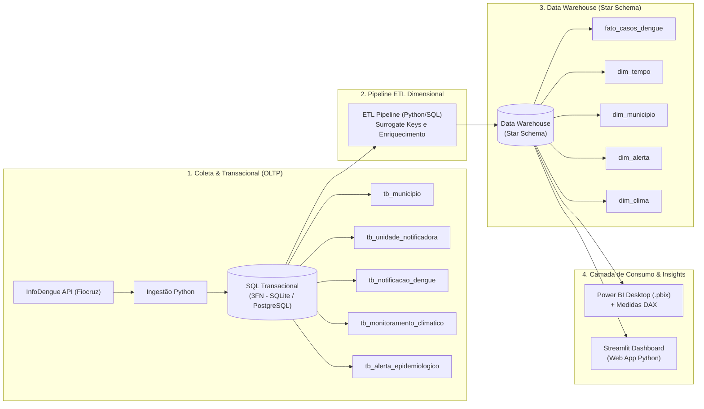

# DataDengue — Arquitetura Analítica e Monitoramento Epidemiológico

Projeto Integrador (FATEC 2026) — **Desafio Business Intelligence: Data-to-Insight Journey**.  
Transformação de dados transacionais e observacionais de vigilância epidemiológica e clima (InfoDengue/Fiocruz) em inteligência analítica para apoio à tomada de decisão na saúde pública de Jundiaí/SP.

---

## 1. Visão Geral da Arquitetura

O ecossistema implementa a jornada completa **Data-to-Insight**, cobrindo desde a ingestão da fonte primária até a modelagem dimensional e camada de visualização:



Consulte a especificação técnica completa em [docs/MODELAGEM_DIMENSIONAL.md](docs/MODELAGEM_DIMENSIONAL.md).

---

## 2. Requisitos

- **Python:** >= 3.13
- **uv:** Gerenciador de pacotes e ambientes virtuais ultrarrápido
- **Acesso à internet:** Para consulta à API InfoDengue (opcional caso utilize cache local)

---

## 3. Instalação e Execução

### 3.1. Sincronizar Dependências
```bash
git clone https://github.com/Arkmedess/DataDengue.git
cd DataDengue
uv sync
```

### 3.2. Executar o Pipeline Completo de Dados
O comando orquestra a coleta da API, alimenta o banco relacional OLTP em 3FN, executa o ETL dimensional e exporta as tabelas do Star Schema:
```bash
uv run python main.py
```

Saídas geradas automaticamente:
* `data/oltp_dengue.db`: Banco transacional em SQLite normalizado em 3FN.
* `data/dw_dengue.db`: Data Warehouse analítico estruturado em Star Schema.
* `data/dw/`: Arquivos CSV prontos para importação no Power BI Desktop (`dim_tempo.csv`, `dim_municipio.csv`, `dim_alerta.csv`, `dim_clima.csv`, `fato_casos_dengue.csv`).
* `data/Dengue_Jundiai.csv`: Extrato consolidado de compatibilidade.

### 3.3. Executar com a Interface Visual Streamlit
Para rodar o pipeline e abrir imediatamente o painel analítico no navegador:
```bash
uv run python main.py --ui
```

### 3.4. Executar Testes Automatizados (TDD)
```bash
uv run pytest
```

---

## 4. O Que os Dados Respondem (Visão de Negócio & Insights)

O painel e as consultas do Data Warehouse foram desenhados para responder perguntas estratégicas da gestão pública de saúde:

1. **Sazonalidade e Picos de Surto:**  
   Em que meses e semanas epidemiológicas o surto de dengue atinge seu ápice em Jundiaí? (Identificado pico expressivo em março/abril com mais de 3.900 casos no mês).
2. **Correlação Climática e Proliferação Vetorial:**  
   Como faixas de temperatura acima de 24°C combinadas com umidade superior a 70% aceleram o ritmo reprodutivo do mosquito e antecipam semanas críticas?
3. **Subnotificação e Nowcasting:**  
   Qual a defasagem entre os casos notificados de imediato e a estimativa real ajustada por modelos estatísticos de nowcasting da Fiocruz?
4. **Alocação de Recursos Sanitários:**  
   Quando o indicador $R_t$ (ritmo de contágio) ultrapassa $1.2$, quais ações preventivas de pulverização veicular (fumacê) e reforço de leitos nas UBSs/UPAs devem ser acionadas antes da saturação hospitalar?

---

## 5. Estrutura do Repositório

```text
DataDengue/
├── data/
│   ├── dw/                               # Datasets dimensionais exportados para Power BI (.csv)
│   ├── dw_dengue.db                      # Data Warehouse analítico SQLite
│   └── oltp_dengue.db                    # Banco de dados transacional relacional
├── docs/
│   └── MODELAGEM_DIMENSIONAL.md          # Especificação do Star Schema e Dicionário de Dados
├── sql/
│   ├── 01_create_transacional_oltp.sql   # DDL transacional 3FN (SQLite / SQL Server / Postgres)
│   ├── 02_create_dw_star_schema.sql      # DDL dimensional do Data Warehouse
│   └── 03_queries_analiticas.sql         # Consultas analíticas prontas de validação
├── src/
│   ├── api_service.py                    # Integração com API InfoDengue
│   ├── dashboard.py                      # Interface analítica interativa Streamlit
│   ├── database.py                       # Gerenciamento de conexões e execução de scripts SQL
│   ├── etl_pipeline.py                   # Pipeline de ETL dimensional (Star Schema generator)
│   ├── models.py                         # Modelos tipados e validadores Pydantic
│   └── oltp_loader.py                    # Carga transacional idempotente
├── tests/
│   ├── test_etl_pipeline.py              # Testes unitários do pipeline dimensional
│   └── test_oltp_loader.py               # Testes unitários da carga OLTP
├── main.py                               # Orquestrador ponta a ponta
├── pyproject.toml                        # Configuração do projeto e dependências uv/pytest
└── README.md                             # Documentação principal
```

---

## 6. Prints do Painel Streamlit


