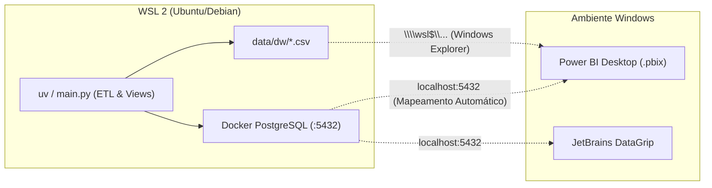

# Guia de Execução: Windows, WSL 2, DataGrip e Power BI

Este guia orienta passo a passo como executar o **DataDengue** em ambiente Windows e WSL 2, inspecionar o banco no **JetBrains DataGrip** e conectar o **Power BI Desktop** para gerar o arquivo `.pbix`.

---

## Cenário 1: WSL 2 + Windows (Fluxo Recomendado)

Se você utiliza o Windows com o subsistema Linux (**WSL 2**), esta é a abordagem mais rápida e limpa: o banco de dados, o Python e as rotinas de ETL rodam dentro do WSL, enquanto o **Power BI Desktop** e o **DataGrip** rodam na interface do Windows.



### 1.1 Dentro do Terminal do WSL
No terminal do seu WSL (ex: Ubuntu), acesse a pasta do projeto:

```bash
# 1. Iniciar o container do PostgreSQL
docker compose up -d

# 2. Executar a carga completa de dados (Dengue, Chikungunya e Zika)
uv run python main.py --all-diseases

# 3. (Opcional) Verificar o status dos schemas e dados populados
uv run python main.py status
```

> **Por que funciona sem configurar rede?**
> O WSL 2 possui espelhamento automático de portas para o Windows host. A porta `5432` aberta no PostgreSQL do WSL fica imediatamente acessível para qualquer aplicativo Windows em `localhost:5432`.

### 1.2 No Windows: Conectar o Power BI Desktop
Abra o **Power BI Desktop** no Windows e escolha uma das formas de conexão:

* **Conexão Direta ao PostgreSQL (Recomendada via Views):**
  1. Vá em **Obter Dados** $\rightarrow$ **Mais...** $\rightarrow$ **Banco de Dados PostgreSQL**.
  2. **Servidor:** `localhost:5432` | **Banco de Dados:** `datadengue`
  3. **Modo:** `Importar`
  4. **Usuário:** `postgres` | **Senha:** `postgres`
  5. No navegador de esquemas, expanda `dw` e marque a view **`dw.vw_star_schema_completo`** (para um modelo pronto com todas as dimensões desnormalizadas) ou marque as tabelas `dw.dim_*` e `dw.fato_casos_dengue`.

* **Conexão via Arquivos CSV (Sem conexão de rede):**
  1. No Power BI, clique em **Obter Dados** $\rightarrow$ **Texto/CSV**.
  2. No campo de caminho do arquivo do Windows Explorer, cole o caminho de rede do WSL:
     ```text
     \\wsl$\Ubuntu\home\<seu-usuario>\Development\DataDengue\data\dw
     ```
  3. Selecione os arquivos `dim_*.csv` e `fato_casos_dengue.csv`.

---

## Cenário 2: Windows Nativo (Sem WSL)

Se você preferir rodar tudo diretamente no PowerShell do Windows:

### 2.1 Pré-requisitos
1. **[Docker Desktop para Windows](https://www.docker.com/products/docker-desktop/)**: Certifique-se de que está aberto e em execução.
2. **[uv](https://docs.astral.sh/uv/)**: No PowerShell, instale com o comando oficial:
   ```powershell
   powershell -ExecutionPolicy ByPass -c "irm https://astral.sh/uv/install.ps1 | iex"
   ```

### 2.2 Execução no PowerShell
Abra o terminal na pasta clonada do repositório:

```powershell
# 1. Subir o PostgreSQL no Docker Desktop
docker compose up -d

# 2. Executar o pipeline (o uv gerencia o Python e dependências automaticamente)
uv run python main.py --all-diseases

# 3. (Opcional) Abrir o dashboard Streamlit localmente
uv run streamlit run src/dashboard.py
```

Os arquivos CSV e o banco estarão disponíveis em `data\dw\` e `localhost:5432`.

---

## Configuração do JetBrains DataGrip

O **DataGrip** permite inspecionar graficamente os schemas `oltp` (3FN) e `dw` (Star Schema), além de visualizar os diagramas de Entidade-Relacionamento (ER).

1. Abra o DataGrip e clique em **`+` (New)** $\rightarrow$ **Data Source** $\rightarrow$ **PostgreSQL**.
2. Preencha as propriedades de conexão:
   - **Host:** `localhost`
   - **Port:** `5432`
   - **Authentication:** `User & Password`
   - **User:** `postgres`
   - **Password:** `postgres`
   - **Database:** `datadengue`
   - **URL:** `jdbc:postgresql://localhost:5432/datadengue`
3. Clique em **Test Connection** (o DataGrip baixará o driver JDBC se for a primeira vez).
4. Clique na aba **Schemas** e marque as caixas de seleção **`oltp`** e **`dw`** (o DataGrip pode ocultá-los por padrão exibindo apenas `public`).
5. Clique em **Apply** e **OK**.

### Visualizando o Diagrama no DataGrip
- Na janela de ferramentas de Banco de Dados, clique com o botão direito sobre o schema **`dw`**.
- Selecione **Diagrams** $\rightarrow$ **Show Diagram...** (ou `Ctrl + Alt + U`).
- O DataGrip renderizará o Star Schema com a tabela `fato_casos_dengue` no centro ligada às 5 dimensões (`dim_tempo`, `dim_municipio`, `dim_alerta`, `dim_clima`, `dim_doenca`).

---

## Resumo dos Recursos Gerados para o Power BI (.pbix)

| Recurso | Localização | Propósito |
| :--- | :--- | :--- |
| **SQL Views** | Schema `dw.vw_*` no PostgreSQL | Consultas prontas: `vw_star_schema_completo`, `vw_sazonalidade_mensal`, `vw_correlacao_clima_casos`, `vw_alertas_criticos`. |
| **Arquivos CSV** | Pasta `data/dw/` | Datasets dimensionais exportados para importação direta no Power BI Desktop. |
| **Medidas DAX** | `dax/medidas_power_bi.dax` | Catálogo com 16 fórmulas DAX prontas (Nowcasting Gap, Incidência por 100k, WoW, MoM, Acumulados). |
| **Guia do Relatório** | `docs/GUIA_POWER_BI.md` | Layout recomendado das telas, cartões de KPI, matrizes e gráficos de dispersão. |
