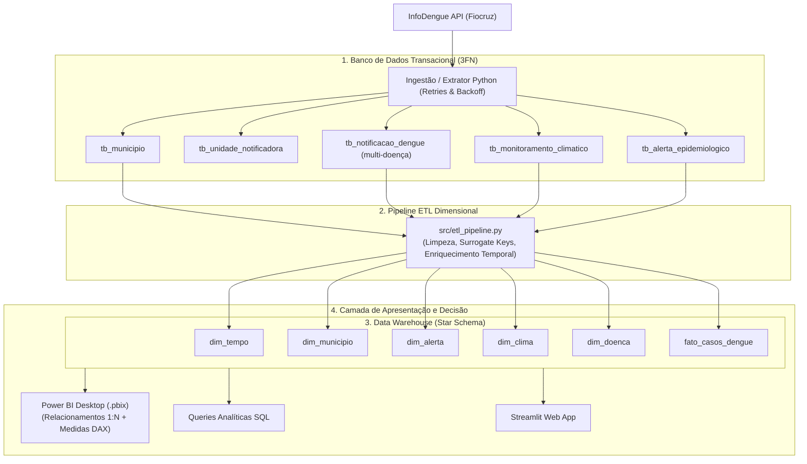
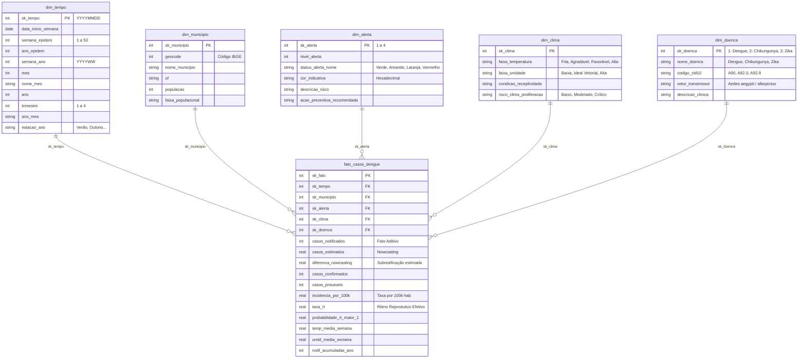

# Documentação Técnica: Modelagem de Dados & Arquitetura Analítica (DataDengue)

Este documento descreve a arquitetura de dados concebida para atender aos requisitos do **Desafio Business Intelligence (Data-to-Insight Journey) — FATEC 2026**.

---

## 1. Topologia da Solução

O projeto implementa a jornada completa desde a ingestão da fonte primária (API InfoDengue/Fiocruz), passando pela normalização transacional (OLTP em 3FN com suporte a múltiplas arboviroses) e pela carga dimensional (Star Schema/OLAP) no Data Warehouse:



---

## 2. Diagrama Entidade-Relacionamento (Star Schema)



---

## 3. Dicionário de Tabelas e Campos

### 3.1. Dimensão Tempo (`dim_tempo`)
Armazena a granularidade cronológica e epidemiológica semanal:
* **`sk_tempo`**: Chave substituta numérica no formato `YYYYMMDD` correspondente ao domingo inicial da semana epidemiológica.
* **`semana_epidem`**: Número da semana de acordo com o calendário epidemiológico do Ministério da Saúde (1 a 53).
* **`estacao_ano`**: Classificação sazonal (Verão, Outono, Inverno, Primavera), fundamental para análises de ciclo vetorial.

### 3.2. Dimensão Município (`dim_municipio`)
Identificação territorial e demográfica:
* **`sk_municipio`**: Chave substituta do município (baseada no código IBGE 3525904 - Jundiaí/SP).
* **`populacao`**: Censo/estimativa IBGE utilizada para o cálculo de incidência por 100 mil habitantes.

### 3.3. Dimensão Alerta (`dim_alerta`)
Tabela dimensional dos níveis de atenção sanitária da metodologia InfoDengue:
* **1 - Verde:** Baixo risco. Monitoramento de rotina.
* **2 - Amarelo:** Atenção epidemiológica. Intensificação de vistorias residenciais.
* **3 - Laranja:** Alerta de transmissão acelerada ($R_t > 1$ sustentado). Mobilização comunitária.
* **4 - Vermelho:** Emergência epidêmica. Abertura de polos de hidratação e nebulização veicular.

### 3.4. Dimensão Condicionantes Climáticos (`dim_clima`)
Categorização dos fatores ambientais que governam a velocidade reprodutiva do mosquito *Aedes aegypti*:
* **`faixa_temperatura`**: Fria ($<18^\circ\text{C}$), Agradável ($18-24^\circ\text{C}$), Favorável ao Vetor ($24-28^\circ\text{C}$), Alta ($>28^\circ\text{C}$).
* **`faixa_umidade`**: Baixa ($<60\%$), Ideal ao Vetor ($60-80\%$), Alta ($>80\%$).
* **`risco_clima_proliferacao`**: Cruzamento ambiental (Baixo, Moderado, Crítico).

### 3.5. Dimensão Doença / Agravo (`dim_doenca`)
Categorização das arboviroses transmitidas pelo mesmo vetor (*Aedes aegypti*):
* **`1` — Dengue:** CID-10 `A90`. Alta transmissibilidade com picos sazonais no outono.
* **`2` — Chikungunya:** CID-10 `A92.0`. Marcada por febre e dores articulares persistentes.
* **`3` — Zika:** CID-10 `A92.8`. Notificações raras em Jundiaí, com monitoramento ativo contra complicações congênitas.

### 3.6. Tabela Fato (`fato_casos_dengue`)
Fatos métricos quantitativos semanais por doença, tempo e clima:
* **`sk_doenca`**: Chave estrangeira ligando à `dim_doenca`.
* **`casos_notificados`**: Casos brutos registrados na semana para a respectiva arbovirose.
* **`casos_estimados`**: Projeção estatística ajustada por atraso de notificação (*nowcasting* da Fiocruz).
* **`diferenca_nowcasting`**: Diferença entre casos estimados e notificados, evidenciando represamento/atraso laboratorial.
* **`incidencia_por_100k`**: $\frac{\text{casos}}{\text{população}} \times 100.000$, padrão epidemiológico internacional.
* **`taxa_rt`**: Número reprodutivo básico efetivo ($R_t > 1$ indica epidemia em expansão).

---

## 4. Prevenção de Erros de Inserção e Resiliência de Dados

Para assegurar confiabilidade no consumo analítico, o pipeline implementa guard-rails em todas as etapas:

1. **Sanitização de Valores Nulos (`NaN`/`None`/`Infinity`):**
   * Contadores numéricos de casos nulos ou negativos são convertidos automaticamente para `0`.
   * Médias meteorológicas ausentes são convertidas para `None` e classificadas na dimensão clima como *"Não Informada"*.
   * Níveis de alerta nulos ou inválidos são corrigidos defensivamente para `1` (Verde).
2. **Isolamento de Poison Pills (Linhas Corrompidas):**
   * O leitor transacional processa cada registro de forma isolada. Se uma linha vier com tipo de data quebrado ou string maliciosa, ela é registrada em `erros_ignorados` e descartada sem abortar o lote de dados válidos.
3. **Resiliência de Rede e Rate Limit:**
   * Requisições HTTP possuem timeout explícito (30s) e política de retry com **Exponential Backoff** (esperas de 1s, 2s e 4s) para códigos 429, 500, 502, 503 e 504.
4. **Idempotência Estrita no Banco:**
   * Utilização de `ON CONFLICT(id_municipio, semana_ano, doenca) DO UPDATE SET` para garantir que reprocessamentos sucessivos atualizem os dados sem duplicar registros.

---

## 5. Como Executar o Pipeline

```bash
# Sincroniza ambiente e dependências
uv sync

# Executa testes unitários e de integração
uv run pytest

# Carga padrão (Dengue, ano 2025)
uv run python main.py

# Carga das 3 arboviroses (Dengue + Chikungunya + Zika) para o período 2020 a 2025
uv run python main.py --all-diseases --start-year 2020 --end-year 2025

# Carga de duas doenças específicas
uv run python main.py --diseases dengue chikungunya --start-year 2024 --end-year 2025

# Menu interativo TUI
uv run python main.py --tui

# Consultar status dos bancos
uv run python main.py status

# Resumo consolidado no terminal
uv run python main.py summary
```
